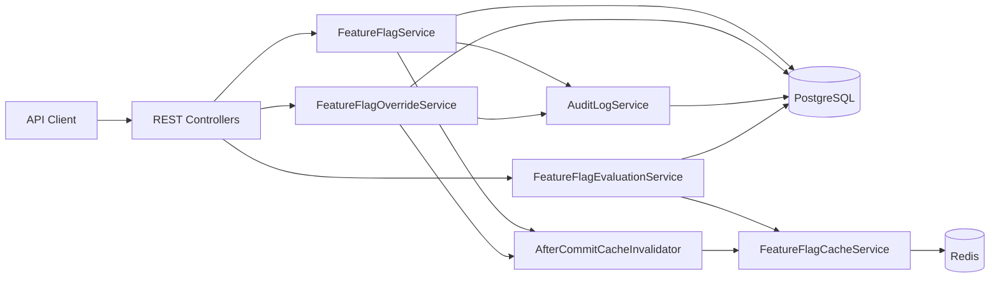

# Feature Flag Management System

REST service for managing feature flags, per-user overrides, cached evaluation, and transactional audit history.

## Objective

Provide a production-oriented MVP that can:

- Create, read, update, and delete global feature flags
- Upsert and delete per-user overrides
- Evaluate whether a flag is enabled for a given user
- Cache evaluation results in Redis with version-aware invalidation
- Persist an audit trail for configuration changes

PostgreSQL is the source of truth. Redis is an optional performance layer; evaluation falls back to PostgreSQL if Redis is unavailable.

## Technology stack

| Layer | Choice |
|-------|--------|
| Language / runtime | Java 21 |
| Framework | Spring Boot 3.5 |
| Build | Maven |
| Database | PostgreSQL 16 + Flyway |
| Cache | Redis 7 |
| Persistence | Spring Data JPA / Hibernate |
| Tests | JUnit 5, Mockito, MockMvc, Testcontainers |
| Local infra | Docker Compose |

## Architecture



Request flow:

1. Controllers accept DTOs and the optional `X-Actor-Id` header on mutating routes.
2. Services enforce business rules inside `@Transactional` boundaries.
3. Evaluation uses cache-aside against Redis, then PostgreSQL on miss or Redis failure.
4. Successful writes bump the flag version and invalidate `flag:{name}` after commit.

## Database schema

Flyway migrations under `src/main/resources/db/migration/`:

| Table | Purpose |
|-------|---------|
| `feature_flags` | Global flag config (`name`, `description`, `enabled`, optimistic `version`, timestamps) |
| `feature_flag_overrides` | Explicit per-user override rows (`flag_id`, `user_id`, `enabled`) |
| `audit_logs` | Immutable-style change history (`flag_id`, `actor`, `action`, JSONB `old_value` / `new_value`) |

Notes:

- Flag names are unique.
- Override uniqueness is `(flag_id, user_id)`.
- Missing override row ≠ `enabled=false`. An explicit false override is a persisted row.
- `audit_logs` has no FK to flags so history survives flag deletion.

## API

Base URL: `http://localhost:8080`

Mutating admin endpoints accept:

```http
X-Actor-Id: admin-42
```

If omitted, the actor defaults to `anonymous`.

### Feature flags

#### `POST /api/v1/flags` → `201`

Name pattern: `^[a-zA-Z][a-zA-Z0-9_-]{0,99}$`

```bash
curl -s -X POST http://localhost:8080/api/v1/flags \
  -H 'Content-Type: application/json' \
  -H 'X-Actor-Id: admin-42' \
  -d '{
    "name": "new_checkout",
    "description": "New checkout flow",
    "enabled": false
  }'
```

```json
{
  "id": "11111111-1111-1111-1111-111111111111",
  "name": "new_checkout",
  "description": "New checkout flow",
  "enabled": false,
  "createdAt": "2026-11-21T05:00:00Z",
  "updatedAt": "2026-11-21T05:00:00Z"
}
```

Duplicate name → `409`. Validation failure → `400`.

#### `GET /api/v1/flags` → `200`

Returns all flags as a JSON array.

#### `GET /api/v1/flags/{name}` → `200` / `404`

#### `PUT /api/v1/flags/{name}` → `200` / `404`

```bash
curl -s -X PUT http://localhost:8080/api/v1/flags/new_checkout \
  -H 'Content-Type: application/json' \
  -H 'X-Actor-Id: admin-42' \
  -d '{
    "description": "New checkout flow",
    "enabled": true
  }'
```

#### `DELETE /api/v1/flags/{name}` → `204` / `404`

### Overrides

#### `PUT /api/v1/flags/{name}/overrides/{userId}` → `200` / `404`

```bash
curl -s -X PUT http://localhost:8080/api/v1/flags/new_checkout/overrides/user123 \
  -H 'Content-Type: application/json' \
  -H 'X-Actor-Id: admin-42' \
  -d '{ "enabled": true }'
```

```json
{
  "flagName": "new_checkout",
  "userId": "user123",
  "enabled": true
}
```

#### `DELETE /api/v1/flags/{name}/overrides/{userId}` → `204` / `404`

### Evaluation

#### `POST /api/v1/evaluate` → `200` / `404`

```bash
curl -s -X POST http://localhost:8080/api/v1/evaluate \
  -H 'Content-Type: application/json' \
  -d '{
    "flagName": "new_checkout",
    "userId": "user123"
  }'
```

```json
{
  "flagName": "new_checkout",
  "userId": "user123",
  "enabled": true,
  "reason": "USER_OVERRIDE"
}
```

`reason` is either `USER_OVERRIDE` or `GLOBAL`.

### Health

```bash
curl -s http://localhost:8080/actuator/health
```

## Evaluation precedence

1. If an override row exists for `(flag, user)` → use that boolean (`reason=USER_OVERRIDE`).
2. Otherwise → use the flag’s global `enabled` value (`reason=GLOBAL`).
3. Unknown flag → HTTP `404` (not cached).

An explicit `enabled=false` override is never treated as “no override”.

## Redis cache

### Architecture

Evaluation uses **cache-aside**:

1. Read `flag:{flagName}` from Redis.
2. On miss, load from PostgreSQL, populate Redis, continue.
3. Read `eval:{flagId}:{flagVersion}:{userId}`.
4. On miss, resolve override/global state from PostgreSQL, populate Redis, return.
5. Redis errors are logged and treated as misses; evaluation still succeeds from PostgreSQL.

TTL for both key types: **60 seconds**.

### Key format

| Key | Value |
|-----|-------|
| `flag:{flagName}` | `{ id, name, enabled, version }` |
| `eval:{flagId}:{flagVersion}:{userId}` | `{ enabled, reason }` |

### Invalidation strategy

- Global flag update / delete and override create / update / delete bump the flag `version` in the **same DB transaction**.
- After a successful commit, `flag:{flagName}` is deleted via `AfterCommitCacheInvalidator`.
- Old evaluation entries are abandoned by key versioning (no Redis `KEYS` / `SCAN`).
- Rolled-back writes do not invalidate cache and do not persist a new version.

**Bounded staleness:** in-flight readers that already loaded a pre-commit snapshot may briefly repopulate stale `flag:{name}` or old-version `eval:*` keys until TTL expiry. Post-commit traffic uses the new version.

## Transactions and audit logging

- State-changing service methods are `@Transactional`.
- Audit rows are written in the **same transaction** as the configuration change.
- A rollback therefore removes both the config mutation and its audit row.

Each audit entry stores:

- `flag_id`
- `actor` (from `X-Actor-Id`)
- `action` (`CREATE` | `UPDATE` | `DELETE`)
- JSONB `old_value` / `new_value`
- `created_at`

There is currently **no public HTTP API** to query audit logs; they are persisted for operational review via the database.

## Local setup

### Prerequisites

- JDK 21 on `PATH` (or set `JAVA_HOME`)
- Maven 3.9+
- Docker / Docker Compose

```bash
java -version
mvn -version
docker compose version
```

### Start infrastructure

From this directory (`workspaces/flag-management-system`):

```bash
docker compose up -d
docker compose ps
```

Postgres is published on host port **5433** (avoids clashing with a local Postgres on 5432). Redis uses **6379**.

### Run the application

```bash
mvn spring-boot:run
```

Optional env overrides: `DB_HOST`, `DB_PORT`, `DB_NAME`, `DB_USER`, `DB_PASSWORD`, `REDIS_HOST`, `REDIS_PORT`, `SERVER_PORT`.

### Tests

Tests start their own PostgreSQL and Redis containers via Testcontainers (Docker required). Compose services are not required for `mvn test`.

```bash
mvn clean verify
```

CI runs the same command on every push and pull request (see `.github/workflows/ci.yml` at the repository root).

## Known limitations and future improvements

**Limitations**

- No authentication/authorization beyond the simplified `X-Actor-Id` header
- No audit-log read API
- Flag list has no pagination/filtering
- Application process is not containerized (only Postgres/Redis via Compose)
- Cache-aside allows brief bounded staleness under concurrent read/write
- Evaluation is single-flag only (no bulk evaluate)

**Possible next steps**

- Authenticated actors and RBAC
- Audit query endpoints
- Bulk evaluation and client SDKs
- Stronger cache consistency (compare-and-set / generation tokens)
- Deployable app image and environment-specific configs
