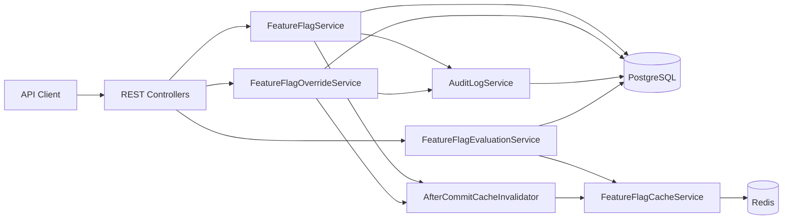

# Feature Flag Management System

REST service for managing feature flags, per-user overrides, cached evaluation, and transactional audit history.

## Documentation

| Doc | Contents |
|-----|----------|
| **This README** | Product overview, architecture sketch, API summary, quick start |
| [docs/ARCHITECTURE.md](docs/ARCHITECTURE.md) | Full architecture, project structure, file-by-file map, services, domain rules, **unit & integration test catalogue** |
| [docs/SETUP_AND_DEMO_GUIDE.md](docs/SETUP_AND_DEMO_GUIDE.md) | Fresh-machine setup after fork/clone, demo checklist, **all endpoints with bodies**, PostgreSQL/Redis inspection (tables, indexes, data) |

## Objective

Provide a production-oriented MVP that can:

- Create, read, update, and delete global feature flags
- Upsert and delete per-user overrides
- Evaluate whether a flag is enabled for a given user
- Cache evaluation results in Redis with version-aware invalidation
- Persist an audit trail for configuration changes

PostgreSQL is the source of truth. Redis is an optional performance layer; evaluation falls back to PostgreSQL if Redis is unavailable.

## Technology stack

| Layer | Choice |
|-------|--------|
| Language / runtime | Java 21 |
| Framework | Spring Boot 3.5 |
| Build | Maven |
| Database | PostgreSQL 16 + Flyway |
| Cache | Redis 7 |
| Persistence | Spring Data JPA / Hibernate |
| Tests | JUnit 5, Mockito, MockMvc, Testcontainers |
| Local infra | Docker Compose |

## Architecture



Request flow:

1. Controllers accept DTOs and the optional `X-Actor-Id` header on mutating routes.
2. Services enforce business rules inside `@Transactional` boundaries.
3. Evaluation uses cache-aside against Redis, then PostgreSQL on miss or Redis failure.
4. Successful writes bump the flag version and invalidate `flag:{name}` after commit.

Details: [docs/ARCHITECTURE.md](docs/ARCHITECTURE.md).

## Database schema

Flyway migrations under `src/main/resources/db/migration/`:

| Table | Purpose |
|-------|---------|
| `feature_flags` | Global flag config (`name`, `description`, `enabled`, optimistic `version`, timestamps) |
| `feature_flag_overrides` | Explicit per-user override rows (`flag_id`, `user_id`, `enabled`) |
| `audit_logs` | Immutable-style change history (`flag_id`, `actor`, `action`, JSONB `old_value` / `new_value`) |

Notes:

- Flag names are unique (`idx_feature_flags_name`).
- Override uniqueness is `(flag_id, user_id)`.
- Missing override row ≠ `enabled=false`. An explicit false override is a persisted row.
- `audit_logs` has no FK to flags so history survives flag deletion.

How to inspect tables, indexes, and live data: [docs/SETUP_AND_DEMO_GUIDE.md](docs/SETUP_AND_DEMO_GUIDE.md#7-inspecting-the-database-postgresql).

## API

Base URL: `http://localhost:8080`

Mutating admin endpoints accept:

```http
X-Actor-Id: admin-42
```

If omitted, the actor defaults to `anonymous`.

Full request/response examples for every endpoint: [docs/SETUP_AND_DEMO_GUIDE.md](docs/SETUP_AND_DEMO_GUIDE.md#6-complete-http-api-reference-for-manual-testing).

### Feature flags

| Method | Path | Status |
|--------|------|--------|
| `POST` | `/api/v1/flags` | `201` / `400` / `409` |
| `GET` | `/api/v1/flags` | `200` |
| `GET` | `/api/v1/flags/{name}` | `200` / `404` |
| `PUT` | `/api/v1/flags/{name}` | `200` / `400` / `404` |
| `DELETE` | `/api/v1/flags/{name}` | `204` / `404` |

Name pattern: `^[a-zA-Z][a-zA-Z0-9_-]{0,99}$`

```bash
curl -s -X POST http://localhost:8080/api/v1/flags \
  -H 'Content-Type: application/json' \
  -H 'X-Actor-Id: admin-42' \
  -d '{
    "name": "new_checkout",
    "description": "New checkout flow",
    "enabled": false
  }'
```

### Overrides

| Method | Path | Status |
|--------|------|--------|
| `PUT` | `/api/v1/flags/{name}/overrides/{userId}` | `200` / `400` / `404` |
| `DELETE` | `/api/v1/flags/{name}/overrides/{userId}` | `204` / `404` |

```bash
curl -s -X PUT http://localhost:8080/api/v1/flags/new_checkout/overrides/user123 \
  -H 'Content-Type: application/json' \
  -H 'X-Actor-Id: admin-42' \
  -d '{ "enabled": true }'
```

### Evaluation

| Method | Path | Status |
|--------|------|--------|
| `POST` | `/api/v1/evaluate` | `200` / `400` / `404` |

```bash
curl -s -X POST http://localhost:8080/api/v1/evaluate \
  -H 'Content-Type: application/json' \
  -d '{
    "flagName": "new_checkout",
    "userId": "user123"
  }'
```

`reason` is either `USER_OVERRIDE` or `GLOBAL`.

### Health

```bash
curl -s http://localhost:8080/actuator/health
```

## Evaluation precedence

1. If an override row exists for `(flag, user)` → use that boolean (`reason=USER_OVERRIDE`).
2. Otherwise → use the flag’s global `enabled` value (`reason=GLOBAL`).
3. Unknown flag → HTTP `404` (not cached).

An explicit `enabled=false` override is never treated as “no override”.

## Redis cache

Evaluation uses **cache-aside**:

1. Read `flag:{flagName}` from Redis.
2. On miss, load from PostgreSQL, populate Redis, continue.
3. Read `eval:{flagId}:{flagVersion}:{userId}`.
4. On miss, resolve override/global state from PostgreSQL, populate Redis, return.
5. Redis errors are logged and treated as misses; evaluation still succeeds from PostgreSQL.

TTL for both key types: **60 seconds**. Writes bump `version` and evict `flag:{name}` after commit; old `eval:*` keys are abandoned by versioning.

## Transactions and audit logging

- State-changing service methods are `@Transactional`.
- Audit rows are written in the **same transaction** as the configuration change.
- A rollback therefore removes both the config mutation and its audit row.
- There is **no public HTTP API** to query audit logs — use SQL (see setup guide).

## Testing

| Kind | Examples |
|------|----------|
| Unit | `FeatureFlagEvaluationServiceTest`, `FeatureFlagCacheServiceTest` |
| HTTP integration | Controller tests, cache invalidation, audit integration |
| End-to-end HTTP flow | **`FeatureFlagEndToEndFlowIT`** (full create → evaluate → override → delete demo path) |

```bash
mvn clean verify
mvn -Dtest=FeatureFlagEndToEndFlowIT test
```

Integration tests share one JVM-wide Postgres/Redis pair (`AbstractIntegrationTest`) so Spring context caching never points at stopped container ports.

Full catalogue: [docs/ARCHITECTURE.md](docs/ARCHITECTURE.md#7-test-suite-catalogue).

## Local setup

### Prerequisites

- JDK 21 on `PATH` (or set `JAVA_HOME`)
- Maven 3.9+
- Docker / Docker Compose

```bash
java -version
mvn -version
docker compose version
```

### Start infrastructure

```bash
docker compose up -d
docker compose ps
```

Postgres is on host port **5433**; Redis on **6379**.

### Run the application

```bash
mvn spring-boot:run
```

Optional env overrides: `DB_HOST`, `DB_PORT`, `DB_NAME`, `DB_USER`, `DB_PASSWORD`, `REDIS_HOST`, `REDIS_PORT`, `SERVER_PORT`.

### Leadership demo

```bash
./scripts/demo-e2e.sh
```

Optional overrides: `BASE_URL`, `FLAG`, `USER_A`, `USER_B`, `ACTOR`.

Complete fresh-machine walkthrough: [docs/SETUP_AND_DEMO_GUIDE.md](docs/SETUP_AND_DEMO_GUIDE.md).

CI runs `mvn clean verify` on every push and pull request (see `.github/workflows/ci.yml` at the repository root).

## Known limitations and future improvements

**Limitations**

- No authentication/authorization beyond the simplified `X-Actor-Id` header
- No audit-log read API
- Flag list has no pagination/filtering
- Application process is not containerized (only Postgres/Redis via Compose)
- Cache-aside allows brief bounded staleness under concurrent read/write
- Evaluation is single-flag only (no bulk evaluate)

**Possible next steps**

- Authenticated actors and RBAC
- Audit query endpoints
- Bulk evaluation and client SDKs
- Stronger cache consistency (compare-and-set / generation tokens)
- Deployable app image and environment-specific configs
