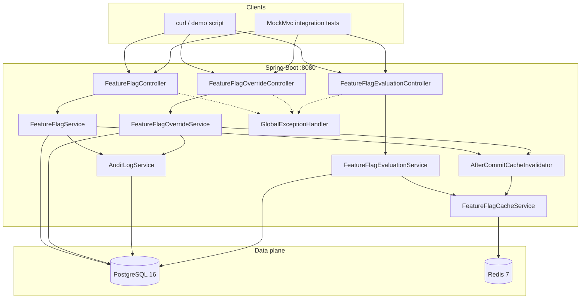

# Architecture & Project Deep Dive

Comprehensive reference for the Feature Flag Management System: architecture, package layout, file responsibilities, services, data model, caching, audit, and the full test suite.

For local setup, API curl recipes, and database inspection on a fresh machine, see [SETUP_AND_DEMO_GUIDE.md](./SETUP_AND_DEMO_GUIDE.md).  
For a shorter overview, see [../README.md](../README.md).

---

## 1. System purpose

A Spring Boot REST API that lets operators:

1. Manage **global** feature flags (CRUD).
2. Set **per-user overrides** (upsert / delete).
3. **Evaluate** whether a flag is enabled for a given user.
4. Persist a **transactional audit trail** of configuration changes.
5. Serve evaluation results through a **Redis cache-aside** layer with version-aware invalidation.

**Source of truth:** PostgreSQL.  
**Performance layer:** Redis (optional; evaluation falls back to PostgreSQL if Redis is down).

---

## 2. High-level architecture



### Request flow (mutating)

1. Controller binds JSON DTO + optional `X-Actor-Id` (default `anonymous`).
2. Service runs inside `@Transactional`.
3. Business rules applied; JPA persists to PostgreSQL.
4. `AuditLogService.record(...)` writes an audit row in the **same** transaction.
5. Flag `@Version` is bumped (directly on flag update, or via `OPTIMISTIC_FORCE_INCREMENT` on override changes).
6. `AfterCommitCacheInvalidator` registers eviction of `flag:{name}` **only after commit**.
7. Response DTO returned; exceptions mapped by `GlobalExceptionHandler`.

### Request flow (evaluate)

1. `POST /api/v1/evaluate` with `{ flagName, userId }`.
2. Resolve flag config: Redis `flag:{name}` → else PostgreSQL → put cache (60s TTL). Missing flag → `404` (not cached).
3. Resolve evaluation: Redis `eval:{flagId}:{version}:{userId}` → else load override or global → put cache.
4. Precedence: **explicit override wins**; else global `enabled`. Reasons: `USER_OVERRIDE` | `GLOBAL`.
5. Redis failures are logged and treated as cache misses; evaluation still succeeds from PostgreSQL.

---

## 3. Technology stack

| Concern | Choice |
|---------|--------|
| Language | Java 21 |
| Framework | Spring Boot 3.5.7 |
| Build | Maven |
| API | Spring Web + Bean Validation |
| ORM | Spring Data JPA / Hibernate 6 |
| Migrations | Flyway |
| DB | PostgreSQL 16 |
| Cache | Redis 7 + Spring Data Redis |
| Observability | Spring Actuator (`/actuator/health`) |
| Tests | JUnit 5, Mockito, MockMvc, AssertJ, Testcontainers |
| Local infra | Docker Compose (Postgres on host `5433`, Redis `6379`) |

---

## 4. Project structure

```text
flag-management-system/
├── README.md                          # Concise product overview + quick start
├── docs/
│   ├── ARCHITECTURE.md                # This document
│   └── SETUP_AND_DEMO_GUIDE.md        # Fresh-machine setup, APIs, DB inspection
├── docker-compose.yml                 # Local Postgres + Redis
├── pom.xml                            # Maven dependencies & Surefire config
├── scripts/
│   └── demo-e2e.sh                    # Leadership curl walkthrough
└── src/
    ├── main/
    │   ├── java/com/digitalocean/flagmanagement/
    │   │   ├── FlagManagementApplication.java
    │   │   ├── cache/                 # Redis cache-aside + after-commit eviction
    │   │   ├── config/                # JPA auditing, RedisTemplate bean
    │   │   ├── controller/            # REST endpoints
    │   │   ├── dto/                   # Request/response records + validation
    │   │   ├── entity/                # JPA entities
    │   │   ├── exception/             # Domain exceptions + @RestControllerAdvice
    │   │   ├── repository/            # Spring Data repositories
    │   │   └── service/               # Business logic + audit helpers
    │   └── resources/
    │       ├── application.yml
    │       └── db/migration/          # Flyway SQL
    └── test/
        ├── java/.../                  # Unit + integration tests
        └── resources/docker-java.properties
```

---

## 5. Package & file catalogue

### 5.1 Bootstrap & config

| File | Role |
|------|------|
| `FlagManagementApplication.java` | `@SpringBootApplication` entry point. |
| `config/JpaConfig.java` | Enables JPA auditing (`@CreatedDate` / `@LastModifiedDate`). |
| `config/RedisConfig.java` | `RedisTemplate<String, Object>` with string keys + Jackson JSON values. |
| `cache/CacheConfig.java` | `RedisCacheManager` (60s TTL). Evaluation uses manual cache-aside via `FeatureFlagCacheService`; this bean supports Spring Cache infrastructure. |
| `application.yml` | Datasource (Postgres `5433`), Redis, Flyway, JPA `ddl-auto: validate`, Actuator, logging. |

### 5.2 Controllers (HTTP surface)

| File | Base path | Endpoints |
|------|-----------|-----------|
| `FeatureFlagController` | `/api/v1/flags` | `POST`, `GET`, `GET /{name}`, `PUT /{name}`, `DELETE /{name}` |
| `FeatureFlagOverrideController` | `/api/v1/flags/{name}/overrides/{userId}` | `PUT`, `DELETE` |
| `FeatureFlagEvaluationController` | `/api/v1/evaluate` | `POST` |

`FeatureFlagController.ACTOR_HEADER` = `X-Actor-Id` (optional, default `anonymous`). Used on all mutating flag/override routes. Evaluation does **not** require an actor.

### 5.3 DTOs

| File | Direction | Fields / validation |
|------|-----------|---------------------|
| `CreateFeatureFlagRequest` | In | `name` `@NotBlank` + pattern `^[a-zA-Z][a-zA-Z0-9_-]{0,99}$`; `description` max 500; `enabled` `@NotNull` |
| `UpdateFeatureFlagRequest` | In | `description` max 500 (nullable clears); `enabled` `@NotNull` |
| `UpsertOverrideRequest` | In | `enabled` `@NotNull` |
| `EvaluateRequest` | In | `flagName`, `userId` both `@NotBlank` |
| `FeatureFlagResponse` | Out | `id`, `name`, `description`, `enabled`, `createdAt`, `updatedAt` |
| `FeatureFlagOverrideResponse` | Out | `flagName`, `userId`, `enabled` |
| `EvaluateResponse` | Out | `flagName`, `userId`, `enabled`, `reason` |

### 5.4 Entities & repositories

| Entity | Table | Notes |
|--------|-------|-------|
| `FeatureFlag` | `feature_flags` | Unique `name`; `@Version` for optimistic concurrency / cache key versioning |
| `FeatureFlagOverride` | `feature_flag_overrides` | Unique `(flag_id, user_id)`; FK to flags `ON DELETE CASCADE` |
| `AuditLog` | `audit_logs` | JSONB `old_value` / `new_value`; **no FK** so rows survive flag delete |

| Repository | Key methods |
|------------|-------------|
| `FeatureFlagRepository` | `findByName`, `existsByName` |
| `FeatureFlagOverrideRepository` | `findByFlagIdAndUserId`, `findByFlagId`, … |
| `AuditLogRepository` | `findByFlagIdOrderByCreatedAtDesc` |

### 5.5 Services

| Service | Responsibility |
|---------|----------------|
| `FeatureFlagService` | Flag CRUD; duplicate detection → `409`; audit; after-commit cache eviction on update/delete |
| `FeatureFlagOverrideService` | Upsert/delete overrides; bumps parent flag version; audit; cache eviction |
| `FeatureFlagEvaluationService` | Cache-aside evaluation; override vs global precedence; does **not** write audit |
| `AuditLogService` | Persist audit rows; helpers `flagValue` / `overrideValue` for JSON snapshots |
| `AuditAction` | Enum: `CREATE`, `UPDATE`, `DELETE` |
| `EvaluationReason` | Enum: `GLOBAL`, `USER_OVERRIDE` |

### 5.6 Cache layer

| File | Role |
|------|------|
| `FeatureFlagCacheKeys` | Key builders: `flag:{name}`, `eval:{flagId}:{version}:{userId}` |
| `CachedFlagConfig` | Cached `{ id, name, enabled, version }` |
| `CachedEvaluation` | Cached `{ enabled, reason }` |
| `FeatureFlagCacheService` | Get/put/evict with 60s TTL; swallows Redis errors (miss / no-op) |
| `AfterCommitCacheInvalidator` | Evicts `flag:{name}` only after successful transaction commit |

### 5.7 Exceptions

| File | HTTP mapping |
|------|----------------|
| `ResourceNotFoundException` | `404` |
| `DuplicateResourceException` | `409` |
| `MethodArgumentNotValidException` (Spring) | `400` (first field error message) |
| Unhandled `Exception` | `500` |
| `ErrorResponse` | `{ timestamp, status, error, message, path }` |
| `GlobalExceptionHandler` | `@RestControllerAdvice` |

### 5.8 Database migrations

| File | Purpose |
|------|---------|
| `V1__baseline.sql` | Baseline placeholder |
| `V2__create_feature_flag_tables.sql` | Creates `feature_flags`, `feature_flag_overrides`, `audit_logs` + indexes |

**Indexes (from migration):**

- Unique: `idx_feature_flags_name` on `feature_flags(name)`
- Unique: `idx_feature_flag_overrides_flag_user` on `(flag_id, user_id)`
- Non-unique: `idx_audit_logs_flag_created_at` on `(flag_id, created_at)`

---

## 6. Domain rules worth remembering

1. **Override presence matters.** No row = inherit global. Row with `enabled=false` = explicit deny (`USER_OVERRIDE`).
2. **Flag name** is the external identifier in URLs; internal UUID is used in cache eval keys and audit.
3. **Version bump** on any config change so old `eval:*` keys are abandoned without Redis SCAN.
4. **Audit is transactional.** Failed/rolled-back mutations leave no audit row.
5. **No auth beyond actor attribution.** `X-Actor-Id` is not validated as a security principal.

---

## 7. Test suite catalogue

All integration tests that need infra extend `support/AbstractIntegrationTest`, which starts **one JVM-wide** Postgres + Redis via Testcontainers (static initializer, no `@Container` stop-between-classes) and wires them with `@ServiceConnection`.

### 7.1 Unit tests (no containers)

| Class | Type | What it covers |
|-------|------|----------------|
| `FeatureFlagEvaluationServiceTest` | Mockito unit | Global on/off; override true/false; missing flag; missing vs explicit-false override; cache hit (no DB); cache miss populate |
| `FeatureFlagCacheServiceTest` | Mockito unit | Redis unavailable on get/put/evict (no exception propagation); wrong payload type; successful get |

### 7.2 HTTP / service integration tests (MockMvc + Testcontainers)

| Class | Focus |
|-------|--------|
| `FeatureFlagControllerTest` | Flag CRUD happy paths; validation `400`; duplicate `409`; missing `404`; cascade delete of overrides; default actor `anonymous`; boundary name/description lengths |
| `FeatureFlagOverrideControllerTest` | Upsert create/update; explicit false; missing flag/enabled; delete success/missing; anonymous actor in audit |
| `FeatureFlagEvaluationControllerTest` | HTTP evaluate cases 1–10 (global, overrides, multi-flag/user, post-update, post-delete-override); validation; health actuator; evaluate does not audit |
| `FeatureFlagCacheInvalidationTest` | Cache miss/hit; ~60s TTL; global update eviction; override update eviction; override delete eviction; flag delete eviction; rolled-back txn does **not** evict |
| `AuditLogIntegrationTest` | Flag + override audit CREATE/UPDATE/DELETE values; actor; timestamps; transactional rollback clears audit; failed validation/404 write no audit; audit survives flag delete |
| `FlagManagementApplicationTests` | Context loads with Testcontainers |

### 7.3 End-to-end showcase integration test

| Class | Purpose |
|-------|---------|
| **`FeatureFlagEndToEndFlowIT`** | **Single HTTP flow** for demos: create → evaluate → enable global → evaluate → override Bob → multi-user evaluate → delete override → fallback → list → get → delete flag → 404 + audit assertions |

Run showcase only:

```bash
mvn -Dtest=FeatureFlagEndToEndFlowIT test
```

Run full suite:

```bash
mvn clean verify
```

### 7.4 Test design notes

- Integration tests use **real** PostgreSQL + Redis (not H2 / embedded Redis).
- Compose services on `5433`/`6379` are for **manual** runs; tests use random Testcontainers ports.
- `src/test/resources/docker-java.properties` sets Docker API version for Engine compatibility.

---

## 8. Runtime configuration summary

| Setting | Default |
|---------|---------|
| HTTP port | `8080` |
| JDBC | `jdbc:postgresql://localhost:5433/feature_flags` |
| DB user/password | `feature_flags` / `feature_flags` |
| Redis | `localhost:6379` |
| Cache TTL | 60 seconds |
| Hikari pool | max 10, min idle 2 |

Env overrides: `DB_HOST`, `DB_PORT`, `DB_NAME`, `DB_USER`, `DB_PASSWORD`, `REDIS_HOST`, `REDIS_PORT`, `SERVER_PORT`.

---

## 9. CI

Repository-root `.github/workflows/ci.yml` runs `mvn clean verify` on push and pull request (requires Docker for Testcontainers).

---

## 10. Known limitations

- No real authentication / RBAC (only `X-Actor-Id` attribution).
- No HTTP API to query audit logs (inspect via SQL).
- No pagination on `GET /api/v1/flags`.
- Single-flag evaluation only (no bulk).
- App process not containerized (only Postgres/Redis via Compose).
- Brief bounded cache staleness under concurrent read/write until TTL.
